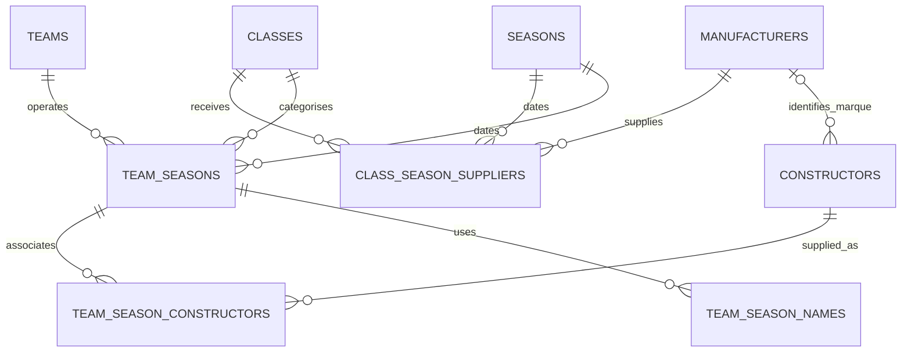

# Manufacturer and team relationships

The constructor-to-manufacturer link is nullable for unresolved/composite labels. The diagram shows the optional collection of constructors attached to each manufacturer; each constructor has zero or one identified marque in this release.

Team seasons are organisation/class/year records, not race entries or guaranteed championship scoring units. A team-season can have multiple names and constructor observations. Exact riders, bike numbers, race-specific constructor use and sporting entrants belong in future race-entry tables.

The four motogp_source tables retain constructor labels, team labels, contextual team mappings and individual source observations. They are the audit trail, not race-result facts. No ownership hierarchy between manufacturers and independent teams is inferred.
